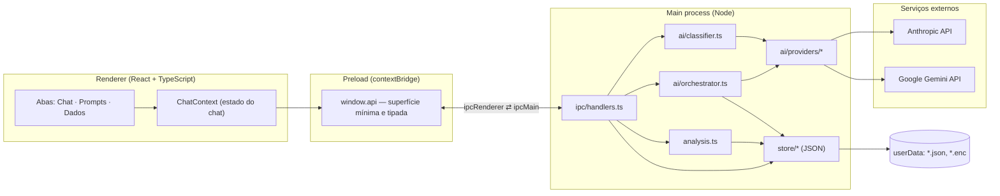
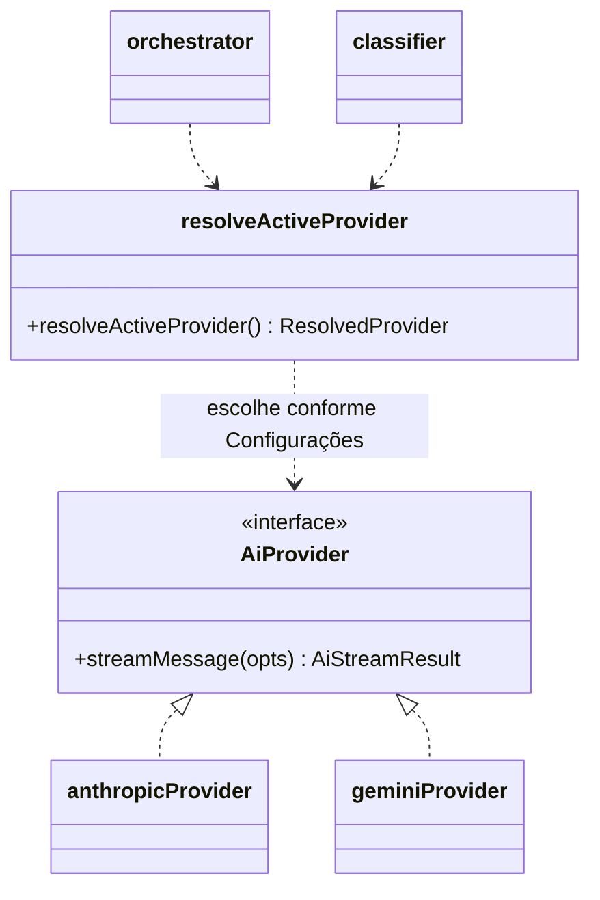
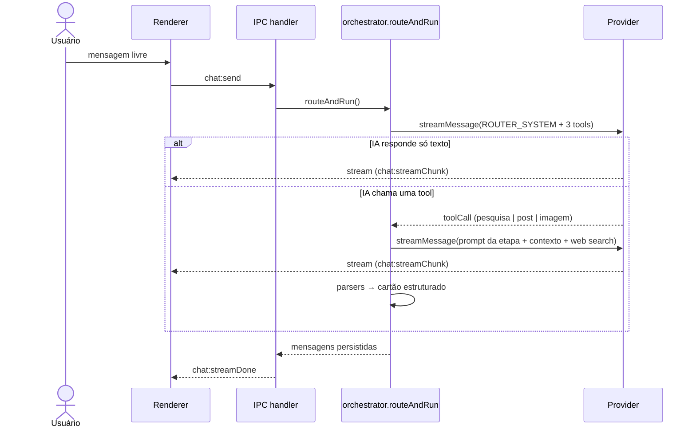

# Arquitetura de software

## 1. Visão geral

Aplicação **Electron** com a separação clássica de três processos/camadas:



### Por que essa separação

| Camada | Responsabilidade | Regra |
|---|---|---|
| **Renderer** | Só interface | Sem acesso a Node, disco ou rede. `contextIsolation: true`. |
| **Preload** | Expor `window.api` | Única ponte; cada método mapeia para um canal IPC nomeado. |
| **Main** | Regras de negócio, IA, disco | Único lugar que conhece chaves de API e fala com provedores. |
| **Shared** | Tipos, canais IPC, prompts-semente | Compartilhado por import (`@shared/*`) para evitar divergência de contrato. |

## 2. Camada de IA: padrão *Adapter*

O ponto central do projeto. O `orchestrator` e o `classifier` **não conhecem** nenhum SDK; falam apenas com a interface `AiProvider`:

```ts
interface AiProvider {
  streamMessage(opts: AiStreamOptions): Promise<AiStreamResult>
}
```



`AiStreamOptions` é o **denominador comum** entre os dois SDKs:

| Campo | Significado | Anthropic | Gemini |
|---|---|---|---|
| `system` | Instrução de sistema | `system` | `systemInstruction` |
| `messages` | Histórico | `MessageParam[]` | `Content[]` (`assistant` → `model`) |
| `tools` | Function calling | `tools[].input_schema` | `functionDeclarations` |
| `enableWebSearch` | Busca na web nativa | `web_search_20260209` | `googleSearch` |
| `onDelta` | Streaming de texto | evento `text` | `generateContentStream` |
| bloco `image` / `document` | Multimodal | `source.base64` | `inlineData` |

**Benefício prático:** trocar de provedor é uma opção de configuração; adicionar um terceiro provedor é criar um arquivo em `providers/` que implemente a interface.

`activeProvider.ts` resolve, a cada chamada, `provedor + chave + modelo` e **falha com mensagem clara** se não houver chave. Nenhuma ação roda "no escuro".

## 3. Fluxos principais

### 3.1 Chat com roteamento de intenção



As 3 *tools* (`iniciar_pesquisa_pautas`, `escrever_post`, `gerar_prompt_imagem`) são só **roteamento**: a tool decide *qual* etapa rodar e extrai o argumento (case ou texto do post); a geração real é uma **segunda chamada** com o prompt editável do usuário. Isso mantém os prompts longos fora das definições de tool e totalmente editáveis na interface.

### 3.2 Etapa do pipeline (ex.: Post)

1. Carrega o prompt editável (`store/prompts`), o provedor ativo e o resumo de performance (`analysis.buildDadosContext`) em paralelo.
2. Monta a mensagem de usuário com um bloco `[CONTEXTO INTERNO DO APP]` explícito, separando dados gerados pelo app do prompt do usuário.
3. Chama a IA com `enableWebSearch: true` (Pesquisa e Post) e `system = prompt + APP_SUGGESTION_INSTRUCTIONS`.
4. `extractSuggestionBlock` separa eventual sugestão de edição de prompt do texto principal.
5. Parsers tolerantes (`parsePautasFromText`, `parsePostBlocks`) transformam o texto em **cartões** tipados (`pautas`, `post`, `imagem`, `sugestao-prompt`).
6. Pautas são persistidas com status (`sugerida → escolhida → publicada | descartada`) para alimentar a regra "não repetir tema".

### 3.3 Classificação de posts


O parser de classificação é **defensivo**: aceita JSON dentro de ```` ```json ````, texto ao redor, e força qualquer valor fora da taxonomia para `outro`. Uma resposta malformada nunca quebra o app.

## 4. Persistência

Sem banco de dados. Cada coleção é um arquivo JSON em `app.getPath('userData')`.

| Arquivo | Conteúdo |
|---|---|
| `settings.json` | provedor ativo, modelo por provedor |
| `apikey-anthropic.enc` / `apikey-gemini.enc` | chaves criptografadas (`safeStorage`) |
| prompts, pautas, dados, conversas | um JSON por coleção (ver `store/`) |

`jsonStore.ts` garante integridade:

- **Escrita atômica**: grava em `.tmp` com UUID e faz `rename`, de modo que uma queda no meio da escrita nunca corrompe o arquivo.
- **Fila por arquivo** (`withFileLock`): serializa leituras/escritas do mesmo arquivo, eliminando *race conditions* (ex.: efeitos duplos do React StrictMode, duas ações lendo e gravando a mesma coleção).
- Erros de uma tarefa não travam a fila da próxima.

## 5. Contrato IPC

Todos os canais são constantes em `src/shared/ipc.ts` (`IPC.chatSend`, `IPC.dadosClassify`, …), agrupados por domínio: `chat:*`, `prompts:*`, `pautas:*`, `dados:*`, `settings:*`. O streaming usa três eventos (`streamChunk`, `streamDone`, `streamError`) correlacionados por `requestId`. Preload e main importam os mesmos nomes, então um erro de digitação vira erro de compilação, não bug de runtime.

## 6. Segurança

| Risco | Mitigação |
|---|---|
| Vazamento de chave de API | Chave só no main process; criptografada com `safeStorage`; renderer recebe apenas `hasApiKey: boolean` |
| Renderer comprometido | `contextIsolation: true`; `window.api` expõe métodos nomeados, não `ipcRenderer` bruto |
| Links externos | `setWindowOpenHandler` nega janelas internas e abre no navegador do sistema |
| IA alterando prompts sozinha | Impossível por design: só gera *sugestões* que o usuário aplica manualmente |
| Dado inventado pela IA | Prompts exigem fonte verificável; a pesquisa usa web search nativo do provedor |

Limitação conhecida: `sandbox: false` na janela, necessário para o preload usar módulos Node. Em app de usuário único e sem conteúdo remoto carregado, o risco é baixo; em um produto multiusuário isso deveria ser revisto.

## 7. Decisões de projeto

| Decisão | Motivo |
|---|---|
| Adapter por provedor | Evitar *lock-in* e permitir comparar Claude × Gemini nos mesmos prompts |
| Tool use só para roteamento | Prompts longos ficam editáveis fora do código |
| JSON files em vez de SQLite | Volume pequeno, usuário único, zero dependência nativa |
| Parsers tolerantes | Saída de LLM é probabilística; o app degrada com elegância |
| Streaming ponta a ponta | Respostas de pesquisa levam dezenas de segundos; o usuário vê o texto surgindo |
| Taxonomia fechada na classificação | Permite agregar e comparar posts; texto livre vai só em campos de nota |
| Limiar mínimo de 20 posts | Evita tirar "padrões" de amostra pequena demais |
| Migração silenciosa de modelos descontinuados do Gemini | O provedor desativou modelos antes da data anunciada; o app troca pelo substituto em vez de quebrar |
| Compatibilidade com configuração legada (`apikey.enc`, campo `model`) | O app nasceu só com Anthropic; a chave e o modelo antigos continuam valendo |
